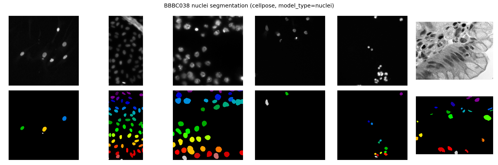

# imaging-ml-practice

Deep-learning image segmentation and quantification for microscopy images
(Cellpose / scikit-image / Python on Google Colab).

## Session 1 (2026-10-20): Cellpose denoising + segmentation on demo images

**Goal.** Learn the Cellpose pipeline end to end on the Cellpose team's own noisy
sample images: denoise → segment → quantify single cells.

**Method.** Google Colab with a T4 GPU. Cellpose (3.x) on the noisy demo images
with near-default settings, then a 3-panel figure (noisy → denoised → segmented)
for visual verification.

**Result.** 97 cells detected and quantified with scikit-image
`regionprops_table` (area, perimeter, eccentricity, mean_intensity) plus a
computed `circularity` column (4π·area / perimeter²). Distributions of area,
circularity, and mean intensity plotted as histograms.

Notebook: `phase1_cellpose_demo.ipynb`

## Session 2 (2026-10-21): BBBC038 nuclei segmentation + quantification

**Goal.** Apply the same pipeline to an independent benchmark set of nuclei images.

**Method.** Colab + T4 GPU; `cellpose<4` (pinned to avoid the v4/CPSAM API change).
Downloaded the BBBC038 stage-1 test set (65 images, 9.5 MB), converted to
grayscale, and segmented 6 images with the pretrained Cellpose
`model_type='nuclei'` model (`channels=[0, 0]`). Same `regionprops_table`
quantification as Session 1, one row per nucleus with an `image_id` column.

**Result.**
- `bbbc038_segmentation.png` — 2×6 comparison figure (input images vs. color-coded
  segmented nuclei) for visual QC.
- `bbbc038_quantification.csv` — per-nucleus measurements
  (label, area, perimeter, eccentricity, mean_intensity, circularity, image_id).

Notebook: `phase1_bbbc038_quantification.ipynb`

**Status.** Phase 1 complete. Next: Phase 2 (scRNA-seq with Scanpy).

## Data sources

- BBBC038: Broad Bioimage Benchmark Collection —
  https://data.broadinstitute.org/bbbc/BBBC038/stage1_test.zip
  (nuclei images used for the 2018 Data Science Bowl; small test subset).
- Cellpose demo images: MouseLand/cellpose repository —
  https://github.com/mouseland/cellpose
